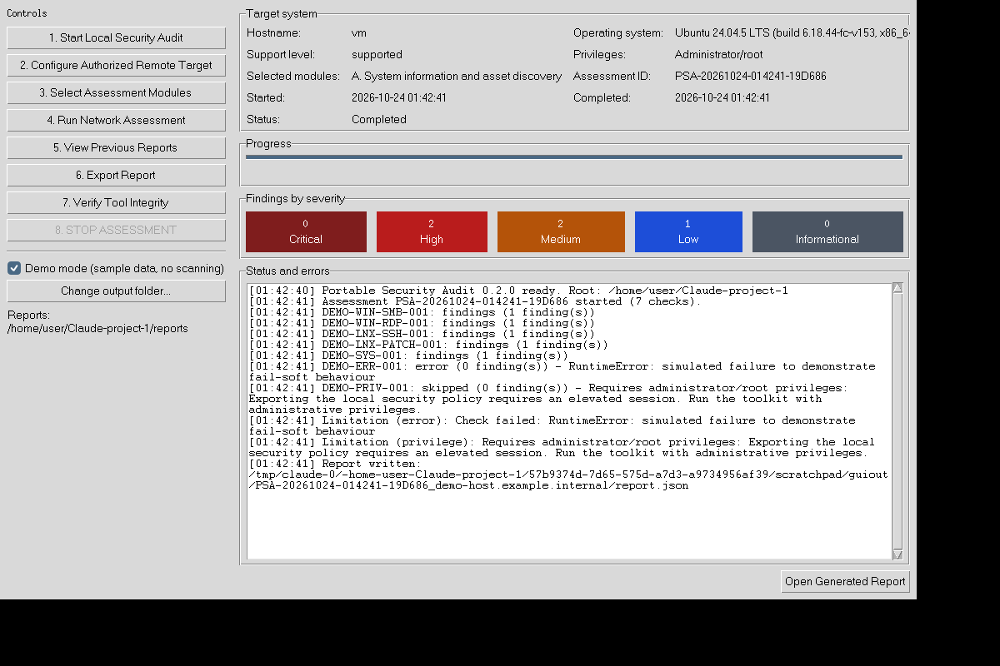

# Portable Security Audit (PSA) Toolkit

A portable, **read-only** security assessment toolkit for IT administrators.
It runs from a USB flash drive and checks the security posture of computers
and servers you are **authorized** to assess.



> ⚠️ **Authorized use only.** The tool refuses to start until the operator
> confirms authorization. It contains **no** exploits, password dumping,
> persistence or antivirus-evasion features, and it **never changes** the
> target's settings. Every run is recorded in a tamper-evident audit log.

| | |
|---|---|
| **Supported targets** | Windows 10 / 11, Windows Server 2019 / 2022 / 2025, Ubuntu 22.04 / 24.04, other Linux distributions (best-effort) |
| **Requirements** | Python 3.10 or newer (standard library only, no `pip install` needed to run it). Tkinter is optional, for the GUI. |
| **Current status** | Phases 1–3, 5 and 6 of 10 complete: 38 read-only checks, risk scoring, offline vulnerability matching, HTML/PDF/CSV reports. See [Project status](#project-status). |

## What it checks

| Module | Checks |
|---|---|
| **A. System information** | Asset identity, OS support, interfaces and connections, listening ports, risky exposed services (Telnet, FTP, SNMP, Redis, Docker API...), installed software |
| **B. Windows** | Firewall profiles, Defender/AV, SMBv1 and signing, RDP/NLA, UAC, password and lockout policy, Guest/local accounts, local admins, patch recency, BitLocker, risky services and unquoted paths, writable service binaries, WDigest/NTLM/LSA/LLMNR, legacy TLS, certificates, audit policy |
| **E. Vulnerabilities** | Installed packages compared with an offline, integrity-checked advisory snapshot (CVE, CVSS, fixed versions); see [docs/VULNDATA.md](docs/VULNDATA.md) |
| **C. Linux** | Pending security updates, SSH configuration, host firewall, UID-0 and privileged groups, sudo rules, empty/weak password hashes, PAM password and lockout policy, world-writable files, sensitive file permissions, SUID/SGID binaries, legacy services, disk encryption, AppArmor/SELinux, kernel sysctl hardening, service certificates |

The full list, including which checks need Administrator/root and why, is in
[docs/CHECKS.md](docs/CHECKS.md).

---

## Table of contents

1. [Get a copy of the project](#1-get-a-copy-of-the-project)
2. [Set up on Windows](#2-set-up-on-windows)
3. [Set up on Linux (Ubuntu)](#3-set-up-on-linux-ubuntu)
4. [Prepare the USB flash drive](#4-prepare-the-usb-flash-drive)
5. [Use the tool: GUI](#5-use-the-tool-gui)
6. [Use the tool: command line](#6-use-the-tool-command-line)
7. [Understand the results](#7-understand-the-results)
8. [Configuration](#8-configuration)
9. [Run the tests](#9-run-the-tests)
10. [Troubleshooting](#10-troubleshooting)
11. [Project structure](#11-project-structure)
12. [Project status](#project-status)

---

## 1. Get a copy of the project

**Option A: download a ZIP (no Git needed)**

1. Open the repository page on GitHub.
2. Click **Code → Download ZIP** and extract it, for example to `C:\PortableSecurityAudit`.

**Option B: clone with Git**

```bash
git clone https://github.com/wan87mail/Claude-project-1.git PortableSecurityAudit
cd PortableSecurityAudit
```

All source code, configuration, documentation, tests and the example report
are inside this folder. Copy the whole folder to keep everything.

---

## 2. Set up on Windows

### 2.1 Install Python (on your admin workstation, not on the target)

1. Download Python **3.12** from <https://www.python.org/downloads/windows/>,
   or run `winget install Python.Python.3.12`.
2. In the installer, tick **"Add python.exe to PATH"** and keep the
   **"py launcher"** option selected. Tkinter is included by default.
3. Open a new **Command Prompt** and check the installation:

   ```bat
   py -3 --version
   ```

### 2.2 First run

```bat
cd C:\PortableSecurityAudit
scripts\PortableSecurityAudit.bat --version
scripts\PortableSecurityAudit.bat info
scripts\PortableSecurityAudit.bat audit --demo
scripts\PortableSecurityAudit.bat
```

The last command opens the GUI.

### 2.3 Optional: developer environment (to run the tests or modify the code)

```powershell
cd C:\PortableSecurityAudit
py -3.12 -m venv .venv
.\.venv\Scripts\Activate.ps1
python -m pip install --upgrade pip
python -m pip install -r requirements-dev.txt
python -m pip install -e .
python -m pytest
PortableSecurityAudit audit --demo
```

> **Note:** a standalone `PortableSecurityAudit.exe`, which runs on target
> PCs *without* Python, will be built with PyInstaller in Phase 8. Until then,
> the Windows target needs Python 3.10+ installed.

---

## 3. Set up on Linux (Ubuntu)

Ubuntu 22.04 and 24.04 already include Python 3.10 / 3.12, so nothing needs to be installed to run the CLI.

```bash
cd ~/PortableSecurityAudit
bash scripts/PortableSecurityAudit.sh --version
bash scripts/PortableSecurityAudit.sh info
bash scripts/PortableSecurityAudit.sh audit --demo
```

GUI (desktop systems only):

```bash
sudo apt install python3-tk        # one-time, on your own admin machine
bash scripts/PortableSecurityAudit.sh
```

Optional developer environment:

```bash
sudo apt install python3-venv
python3 -m venv .venv && . .venv/bin/activate
pip install -r requirements-dev.txt && pip install -e .
python -m pytest
```

---

## 4. Prepare the USB flash drive

Do this on a **trusted** admin machine.

1. **Format** the drive (exFAT works on both Windows and Linux) and name it, for example, `PSA`.
2. **Copy** the project folder to the drive, for example `E:\PortableSecurityAudit\`.
3. **Create the integrity manifest.** This must be the last step, after all files are copied:

   ```bat
   cd /d E:\PortableSecurityAudit
   scripts\PortableSecurityAudit.bat build-manifest
   ```

   If you use Module E, first copy a vulnerability snapshot to `vulndata/`
   ([docs/VULNDATA.md](docs/VULNDATA.md)), because the manifest must cover it.

   It prints a line like `Manifest SHA-256: 3f9a…`. **Record this value** in
   your change ticket or release notes, kept somewhere other than the USB drive.
4. **Before every engagement, verify** the drive:

   ```bat
   scripts\PortableSecurityAudit.bat verify
   ```

   Check that it says `PASSED` and that the manifest SHA-256 matches the value you recorded.
   If it says `FAILED`, do **not** use the drive; rebuild it from a trusted copy.
5. Optional: if you want the drive to be write-protected, set
   `output_dir` in `config/local.toml`, or use `--output`, so that reports are saved elsewhere.

> The toolkit **never runs automatically** when the USB is inserted (there is
> no `autorun.inf`). The operator always launches it manually.

---

## 5. Use the tool: GUI

Start it:
- **Windows:** double-click `scripts\PortableSecurityAudit.bat`. For more complete results, right-click → **Run as administrator**.
- **Linux:** run `bash scripts/PortableSecurityAudit.sh`, or `sudo bash …` for more complete results.

| Control | What it does |
|---|---|
| **1. Start Local Security Audit** | Shows the authorization notice. You must enter your **name** and an **authorization reference** (ticket or letter number) and tick the confirmation box before **Start** becomes clickable. |
| **2. Configure Authorized Remote Target** | Adds remote IPs, CIDR ranges (at most 256 hosts by default) or hostnames, each with its own permission reference. **Preview** validates an entry without sending any traffic. |
| **3. Select Assessment Modules** | Chooses which modules run. Modules that don't apply to this OS are shown greyed out with the reason. |
| **4. Run Network Assessment** | Shows a dry-run preview (hosts, ports, connection count, minimum duration) before any traffic. *The network scanning module arrives in Phase 4.* |
| **5. View Previous Reports** | Lists past reports; you can open, verify or export them. |
| **6. Export Report** | Copies the latest report folder to a location you choose. Nothing is ever uploaded. |
| **7. Verify Tool Integrity** | Checks every file on the drive against the manifest. |
| **8. STOP ASSESSMENT** | Emergency stop: running checks are terminated immediately. Partial results are saved and marked *stopped*. |

The dashboard shows the hostname, OS, start and finish time, progress, a
count of findings per severity, and a status log that explains every skipped
or failed check. **Open Generated Report** opens the result.

💡 Tick **Demo mode** to practise with sample findings. Demo mode runs no
commands and sends no network traffic.

---

## 6. Use the tool: command line

Every function works without a GUI, which is useful on servers. Replace
`PSA` below with `scripts\PortableSecurityAudit.bat` (Windows) or
`bash scripts/PortableSecurityAudit.sh` (Linux).

```bash
PSA info                      # detected OS, privileges, and which checks will run or be skipped (and why)
PSA modules -v                # list modules and checks with their requirements
PSA audit --demo              # safe demonstration with sample findings
PSA audit                     # real local audit; prompts for name, reference and "I AM AUTHORIZED"
PSA audit --output D:\reports # save reports elsewhere (for a read-only USB drive)
PSA reports                   # list previous reports
PSA verify                    # verify tool integrity
PSA verify-report <report folder> # verify no report file has been altered
PSA export-report <report folder> <dest> --formats html,pdf,csv   # copy/re-render for the IT administrator
PSA verify-log <audit.jsonl>      # verify the audit log hash chain
PSA preview-scan --target 10.0.5.0/28 --ports 22,443   # dry run; sends NO traffic
```

**Scripted (non-interactive) runs** must state the authorization explicitly:

```bash
PSA audit --operator "Jane Admin" --reference "CHG-1234" \
          --scope "Finance file server" --confirm "I AM AUTHORIZED"
```

**Remote targets** need a matching permission reference for each target:

```bash
PSA audit --target 10.0.5.20 --target-ref "CHG-1234" \
          --target 10.0.6.0/28 --target-ref "CHG-1235"
```

Press **Ctrl+C** at any time for an emergency stop.

**Exit codes:** `0` OK · `1` error · `2` usage error · `3` authorization refused · `4` integrity failure · `130` stopped.

---

## 7. Understand the results

Each assessment creates its own folder:

```
reports/PSA-20261024-091500-AB12CD_<hostname>/
    report.html            readable report: executive summary, roadmap, findings (open this first)
    report.pdf             the same report for management and audit files
    findings.csv           one row per finding, with owner / due date / ticket columns for tracking
    report.json            complete machine-readable results (all other formats are built from it)
    report.json.sha256     hash of report.json
    SHA256SUMS             hashes of every file above (sha256sum -c compatible)
logs/audit-PSA-20261024-091500-AB12CD.jsonl   hash-chained audit trail of the run
logs/psa-YYYYMMDD.log                         application log
```

A complete sample (HTML, PDF, CSV, JSON) is in [`docs/examples/demo-report/`](docs/examples/demo-report/), with its audit log in [`docs/examples/demo-audit-log.jsonl`](docs/examples/demo-audit-log.jsonl).

Every finding contains:

- **ID, title, severity** (Critical / High / Medium / Low / Informational) and the **reason** for that severity
- **Status:** `confirmed` (directly observed), `potential` (indirect evidence, such as a version string), `informational`, or `inconclusive`
- **Confidence**, affected host and component, description, **evidence**, impact
- **References:** CVE (with CVSS score, version and source), CWE, or baseline item
- **Remediation**, verification steps, and whether manual validation is required

Every finding also gets a **risk score** (0–10, used to rank work: severity ×
certainty) and a **priority**: *immediate*, *short-term*, *planned* or
*monitoring*. The report starts with an overall **security posture** rating
(Critical / High / Elevated / Moderate / Low risk) that explains its reason
and the check coverage it is based on.

The **limitations** section lists every check that was skipped (missing
privileges, missing tool, no authorized target), failed or timed out, so that
gaps in coverage are visible.

Passwords, tokens, private keys and similar secrets are automatically
**redacted** from evidence, logs and reports.

---

## 8. Configuration

Defaults are in [`config/default.toml`](config/default.toml). **Don't edit
that file on the drive**, because it is covered by the integrity manifest.
Create `config/local.toml` with only the values you want to change:

```toml
[general]
output_dir = "D:\\PSA-Reports"   # where reports go (if the USB is read-only)

[execution]
command_timeout_seconds = 60

[network]
max_hosts_per_target = 64
rate_limit_per_second = 20
```

Unsafe values are automatically limited to hard maximums (for example, at
most 1024 hosts, 64 concurrent connections and 200 connections per second),
and a warning is logged.

---

## 9. Run the tests

```bash
python -m pip install pytest
python -m pytest                                        # 390+ tests, mocked; no system changes
xvfb-run -a python -m pytest tests/test_gui_smoke.py    # GUI test on Linux (needs python3-tk)
```

---

## 10. Troubleshooting

| Problem | Solution |
|---|---|
| `The GUI is unavailable` | Tkinter or a display is missing (normal on servers). Use the CLI commands. |
| `Output directory ... is not writable` | The USB drive is write-protected or full. Use `--output <folder>` or **Change output folder…**. |
| `Authorization refused` (exit 3) | A name or reference is missing, or the phrase was not typed exactly as `I AM AUTHORIZED`. |
| `Integrity check FAILED` (exit 4) | Files changed since the drive was prepared. Don't use the drive; rebuild it from a trusted copy. |
| Many checks show `skipped: Requires administrator/root` | Run elevated (*Run as administrator* or `sudo`) if your authorization allows it. |
| `Python 3.10+ was not found` (Linux) | Install Python 3.10+ on the host, or wait for the frozen Linux build (Phase 8). |
| `'py' not found` (Windows) | Install Python with the **py launcher** option (see 2.1). |
| Blocked by antivirus or AppLocker | Ask your endpoint-security team to allow the tool. It does not attempt to bypass security controls. |

---

## 11. Project structure

```
PortableSecurityAudit/
├── README.md, LICENSES.md, pyproject.toml, requirements-dev.txt
├── config/default.toml          default safe settings (add config/local.toml for overrides)
├── scripts/
│   ├── PortableSecurityAudit.bat    Windows launcher
│   ├── PortableSecurityAudit.sh     Linux launcher
│   └── build_manifest.py            create the integrity manifest
├── src/psatoolkit/
│   ├── cli.py                   command-line interface
│   ├── gui/app.py               Tkinter dashboard
│   ├── core/                    engine, authorization, safe command runner, validation,
│   │                            OS detection, config, logging, integrity, redaction
│   ├── modules/                 assessment modules (system_info, demo; more in later phases)
│   └── reporting/               report writers (JSON, HTML, PDF, CSV) and report integrity
├── tests/                       automated tests
├── docs/                        architecture, user guide, developer guide, phases, examples
├── vulndata/                    offline vulnerability snapshot for Module E (you build it; see docs/VULNDATA.md)
├── baselines/  tools/           reserved for later phases
├── reports/  logs/              created at run time (not stored in Git)
└── checksums/                   integrity manifest (created when preparing the drive)
```

More detail:
[Architecture](docs/ARCHITECTURE.md) ·
[Check catalogue](docs/CHECKS.md) ·
[User guide](docs/USER_GUIDE.md) ·
[Developer guide](docs/DEVELOPMENT.md) ·
[Licences](LICENSES.md)

---

## Project status

| Phase | Scope | Status |
|---|---|---|
| 1 | Architecture and project structure | ✅ Done |
| 2 | Portable shell, authorization, engine, GUI and CLI, JSON report, integrity, demo mode | ✅ Done |
| 3 | Windows and Linux read-only security checks | ✅ Done |
| 4 | Controlled network assessment | Not included in this build |
| 5 | Risk scoring and vulnerability data (CVE/CVSS) | ✅ Done |
| 6 | HTML, PDF and CSV reports | ✅ Done |
| 7 | Security baselines and expanded demo | ⏳ Planned |
| 8 | Standalone Windows `.exe` and Linux build | ⏳ Planned |
| 9–10 | Security review, final documentation, release checklist | ⏳ Planned |

The Windows checks have been tested against mocked PowerShell output, not yet
on a real Windows host. Run [docs/TEST_CHECKLIST.md](docs/TEST_CHECKLIST.md)
before field use. Details are in [docs/PHASES.md](docs/PHASES.md).
